# TastyWaves

**A wavetable synthesizer firmware for the M-VAVE FM-1.**

TastyWaves turns the FM-1 into a 12-voice wavetable synth with two oscillators per voice, a resonant filter, two
envelopes, an LFO, a four-slot effects chain, an arpeggiator and two step sequencers that can play chords and
counterpoint on one clock. Patches are saved on the device, and a browser tool manages them and loads your own
wavetables in four common wavetable formats. The philosophy of TastyWaves is to do one thing well and in depth,
focusing on intuitive performance and usability, and to provide a rich nuanced sound engine equally useful for
creating pattern-based music and evolving soundscapes. We aim to be the definitive wavetable synth on the FM-1.

<p align="center">
  
  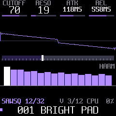
  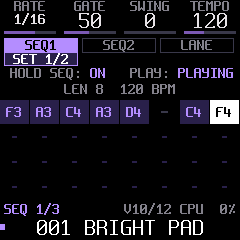
</p>

> **Version 1.0.0.** Tested on the FM-1 against [docs/DEVICE-TEST-PLAN.md](docs/DEVICE-TEST-PLAN.md).
> It is free software (GPL-3.0), built on [Dinghy](https://github.com/zvenson/dinghy), which is built on
> [Felucca](https://github.com/hugelton/Felucca) and [SLOOP](https://github.com/isod89/sloop-fm1). See [Credits](#credits-and-licence).

## Contents

- [Features](#features)
- [Install](#install)
- [Playing it](#playing-it)
- [The pages](#the-pages)
- [Arpeggiator and sequencers](#arpeggiator-and-sequencers)
- [Patches](#patches)
- [The web tool: your own wavetables, patch library](#the-web-tool-your-own-wavetables-patch-library)
- [MIDI and USB audio](#midi-and-usb-audio)
- [Build from source](#build-from-source)
- [Credits and licence](#credits-and-licence)

## Features

| | |
| --- | --- |
| **Voices** | 12 voices, POLY, MONO or LEGATO, with glide; HI or ECO quality |
| **Oscillators** | 2 wavetable oscillators per voice, each with its own table, position, semitone, fine tune and level; a sub oscillator and noise; BEND, a wave warp on either or both oscillators |
| **Wavetables** | 12 built-in tables of 32 frames (SAWSQ, PWM, HARM, VOWEL, FMIDX, FOLD, ORGAN, BELL, NOISE, SHAPE, REED, STAIR), band-limited, plus 8 slots for your own tables (Serum, WaveEdit, Ableton or Surge exports) |
| **Filter** | Resonant state-variable filter: low-pass, band-pass, high-pass, with key tracking |
| **Envelopes** | AMP and MOD ADSR envelopes; MOD moves the cutoff, the table position and BEND; linear or exponential curves |
| **LFO** | Sine, triangle, saw, square, sample and hold; to position, pitch, cutoff and amplitude |
| **Control** | Mod wheel to position and vibrato, aftertouch to cutoff, velocity to amplitude and cutoff, pitch bend range, volume, drive |
| **Effects** | A chain of 4 slots: chorus, flanger, phaser, delay, reverb. Hold FX to bypass the chain (a click-free crossfade; delay and reverb tails keep ringing underneath) |
| **Arpeggiator** | UP, DOWN, UP-DN, UP-DN2, RANDOM, PLAYED, CHORD; 1/4 to 1/32 with triplets; 1 to 4 octaves; gate, swing, tempo 40 to 240 BPM; LATCH |
| **Two sequencers** | SEQ1 and SEQ2, 32 steps each, with rests and ties, on one clock. Each has its own rate, gate, swing, chord, arpeggiator, octaves and level; both are mixed through a soft clip. Held keys transpose both |
| **Chords** | Every step can play a chord: MAJ, MIN, 7, MAJ7, MIN7, SUS4, or HELD (the shape of the keys you hold). Shown on a keyboard |
| **Modulation lane** | A value per step of SEQ1 that moves position, cutoff, BEND or drive, with depth and glide |
| **Patches** | 8 factory patches and 32 of your own, saved on the FM-1 with both sequences |
| **Sync** | Follows MIDI clock (Start restarts the patterns on the beat) |
| **USB** | Class-compliant USB-MIDI in and out; the FM-1 is also a 16-bit stereo USB audio input at 44.1 or 48 kHz |
| **Screen** | An animated splash at power-on (waves crash, the name rises out of the spray); a picture for every page: the wave, the filter response, the envelopes, the LFO, the effects chain, the arpeggio, the pattern; three HOME looks; built-in help |
| **Safe** | The FM-1's update path and USB rescue stay intact: you can always install another firmware |

## Install

You need an M-VAVE FM-1, a USB cable and a computer with Python 3.

1. Download `tastywaves-1.0.0.fwsc` from the [Releases](https://github.com/marksweiss/tastywaves/releases) page.
2. Get the installer (this repository) and its two Python packages:

   ```sh
   git clone https://github.com/marksweiss/tastywaves.git
   cd tastywaves
   python3 -m venv .venv && .venv/bin/pip install mido python-rtmidi
   ```

3. Plug in the FM-1, switch it on, and install:

   ```sh
   tools/install_fw.sh ~/Downloads/tastywaves-1.0.0.fwsc
   ```

   It shows what runs on the FM-1, asks before it writes, and checks the result after the FM-1 restarts.
   `tools/install_fw.sh --info` shows what is installed.

**If something goes wrong:** hold **OCT-** while switching the FM-1 on. It starts in the USB rescue (no sound,
only the updater), and the install works from there. A firmware that crashes twice at boot lands there by itself.

**Going back:** the [FM-1 Firmware Hub](https://fm1.designburgapps.com) installs the official firmware, or any
other, over the same USB update path. Back up your patches with the [web tool](#the-web-tool-your-own-wavetables-patch-library) first.

## Playing it

The four knobs under the screen always set the four values shown at the top of the page you're on. A page
button opens its page; pressing it again steps through the page's tabs.

| Control | What it does |
| --- | --- |
| **Keys** | Play (velocity sensitive); the notes also go out over USB-MIDI |
| **OCT- / OCT+** | Octave down / up (remembered) |
| **KNOB 1-4** | The four values at the top of the screen |
| **ALGORITHM** | The wavetable (factory, then your own) |
| **SELECT** | The position in the table (on the LANE tab: the step) |
| **PRESETS** | The patch: factory 1-8, then your U01-U32 (loads after a short pause) |
| **HOME** | Back to HOME (four knobs: cutoff, resonance, attack, release); hold it for HELP |
| **EDIT FX ENV LFO SEL GLO** | Open that page; again: its next tab |
| **ARP / SEQ** | Press: open its page. Hold half a second: switch it on or off (the button lights when on) |
| **FX** | Press: the FX page. Hold: bypass the effects chain (`HOLD FX: BYPASS`) |
| **PLAY** | With SEQ lit: start / stop both sequences, from any page. Otherwise: LATCH (held notes keep sounding) |
| **REC** | On the SEQ page: step input for the sequence shown. Hold, then REC again: clear it |
| **SAVE** | Save the patch (see [Patches](#patches)) |
| **MASTER** | Volume |

The line above the patch name shows the page and tab, the voices in use (`V 3/12`, an `L` when LATCH is on) and the
CPU load.

## The pages

| | |
| --- | --- |
| 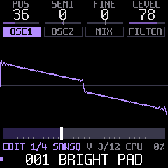 | **EDIT**: OSC1 and OSC2 (position, semitone, fine, level; the wave drawn as it plays, BEND included), MIX (sub, noise, BEND and where it goes, the levels), FILTER (cutoff, resonance, mode, key tracking, with the response curve) |
| 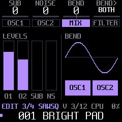 | **MIX**: the four levels and BEND on a sine, with the oscillators it acts on |
| 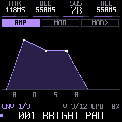 | **ENV**: AMP and MOD envelopes, drawn; MOD> sets what the MOD envelope moves (cutoff, position, BEND) and the curve |
| 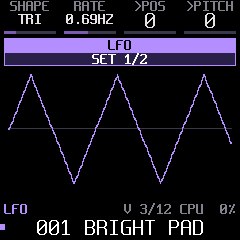 | **LFO**: shape and rate, to position and pitch (set 1) or cutoff and amplitude (set 2) |
| 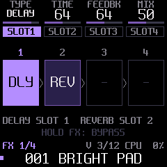 | **FX**: four slots in series, each a TYPE with two values and a MIX. Delay and reverb take one slot each |
| 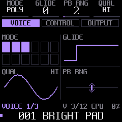 | **SEL**: VOICE (mode, glide, bend range, quality), CONTROL (mod wheel, aftertouch, velocity routes), OUTPUT (volume, drive, velocity to cutoff) |
| 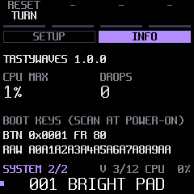 | **GLO**: SETUP picks the HOME look (waterfall, spectrum, minimal); INFO shows the version, the highest CPU load and any audio drops |

## Arpeggiator and sequencers

<p>
  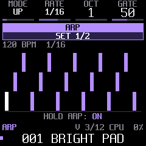
  
  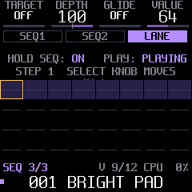
</p>

**The arpeggiator.** Hold **ARP** to switch it on (`HOLD ARP: ON`), then hold notes. Press **PLAY** for LATCH and
let go: the arpeggio keeps playing while you turn knobs. Press ARP to set MODE, RATE, OCT, GATE (set 1) and
SWING, TEMPO (set 2).

**Recording a sequence.**

1. Press **SEQ** to open its page (SEQ1, SEQ2 and LANE tabs; press SEQ again to step through them).
2. On the SEQ1 or SEQ2 tab, press **REC**. Each key you play is a step; **PLAY** enters a rest, **SEQ** ties the
   step before. Press **REC** again to finish (or stop at 32 steps).
3. Hold **SEQ** to switch the sequencer on, then press **PLAY**. The status row on every SEQ tab shows
   `HOLD SEQ: ON / OFF` and `PLAY: PLAYING / STOPPED`.
4. Hold a key to transpose: the pattern moves by that key minus C4. LATCH a key to keep it transposed.

**Two sequences.** SEQ1 and SEQ2 share the tempo and PLAY, and start together. Each has its own RATE, GATE and SWING
(set 1) and CHORD, ARP, OCT and LEVEL (set 2), so SEQ2 can run at 1/8 against SEQ1's 1/16, or arpeggiate chords
under a plain melody. LEVEL balances them; the mix is soft-clipped, so thick textures stay clean.

**Chords.** CHORD makes every step play a chord on its note: a fixed shape (MAJ, MIN, 7, MAJ7, MIN7, SUS4) or HELD,
the shape of the keys you hold (the lowest one is the root). The chord tab draws it on a keyboard, the root in
amber. With the pattern's ARP on, each step lasts a beat and the arpeggiator plays its chord at RATE.

**The modulation lane.** The LANE tab holds one value per step of SEQ1. TARGET picks what it moves (position,
cutoff, BEND, drive), DEPTH how far, GLIDE whether it slides between steps. SELECT picks the step and the fourth knob
sets its value.

With external MIDI clock the arpeggiator and both sequences follow it; MIDI Start restarts them on the beat.

## Patches

**Loading.** Turn **PRESETS**: the 8 factory patches come first, then your saved ones (U01 to U32).

**Saving.** The SAVE button lights when the sound differs from the patch it came from.

- Press **SAVE**: a user patch is saved over itself; a factory patch goes to the first free number.
- Hold **SAVE** and turn **PRESETS** to pick another number (a number in use asks first: press SAVE again).
- Hold **SAVE** for 2 seconds on a user patch to delete it (press SAVE again to confirm).

A patch holds every sound setting, the arpeggiator settings, both sequences with their settings, and the
modulation lane. ARP, SEQ and the bypass are performance switches: changing patches doesn't stop a running
sequence. The patch store holds about 32 patches without sequences and fewer with long ones; SAVE says
`STORE FULL` when it is.

## The web tool: your own wavetables, patch library

<p align="center">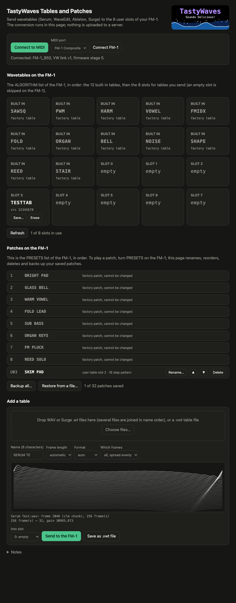</p>

A page in your browser that talks to the FM-1 over USB-MIDI. It runs locally; nothing is uploaded anywhere.

```sh
tools/web_tool.sh                    # in this repository: opens http://localhost:8000 in your browser
```

Use Chrome or Edge (Safari has no Web MIDI), press **Connect to MIDI** and allow SysEx.

- **Wavetables:** drop a wavetable WAV (Serum, WaveEdit, Ableton) or a Surge `.wt` file, check the preview and send
  it to one of the 8 user slots. ALGORITHM lists it after the factory tables. Save a slot to a `.vwt` file to keep it.
- **Patches:** one list in PRESETS order. Rename, reorder, delete, and back up all your patches to a JSON file (both
  sequences included); restore puts them back.

[tools/web/README.md](tools/web/README.md) has the details, and `tools/fm1_wavetable.py` does the same conversion on
the command line.

## MIDI and USB audio

- **In:** notes with velocity, pitch bend, channel aftertouch, mod wheel (CC 1), MIDI clock and Start, and a CC
  map for most sound parameters ([firmware/src/patch.h](firmware/src/patch.h), `patch_cc`). All Notes Off and All
  Sound Off release everything, latched notes included.
- **Out:** the notes you play on the keys.
- **USB audio:** the FM-1 appears as a stereo audio input; record it in any DAW without a cable.

## Build from source

You need Linux on x86-64, or macOS or Windows with Docker (the build runs the chip's toolchain in a `linux/amd64`
container by itself), plus Python 3 and [uv](https://docs.astral.sh/uv/).

```sh
tools/install.sh        # once: a venv, JieLi's toolchain, three files of the JieLi AC79 SDK; then a build and a host test
./build.sh              # -> build/tastywaves.fwsc
./build.sh --release 1.0.0    # -> build/tastywaves-1.0.0.fwsc
tools/install_fw.sh     # install build/tastywaves.fwsc on the connected FM-1
```

The build refuses what would break the FM-1: a 64-bit division, a call into the chip ROM, too much RAM, a hardware
register touched outside `firmware/hal/`.

**Host mode** runs the same firmware on your computer, with no FM-1: a script presses keys and turns knobs; out come
the sound as a WAV and the screen as images. Every screenshot here was made that way.

```sh
tests/run_host.sh       # -> build/host/tastywaves.wav and screen PNGs
tests/run_panel.sh      # the panel; tests/run_*.sh are the test suites
```

Where to read next: [docs/CODEMAP.md](docs/CODEMAP.md) (the code), [docs/RULES.md](docs/RULES.md) (the chip's rules:
integers only, the audio interrupt's budget), [docs/API.md](docs/API.md) (the platform), and the design notes:
[WAVETABLE_DESIGN](docs/WAVETABLE_DESIGN.md), [SYNTH-DESIGN](docs/SYNTH-DESIGN.md), [ARP-SEQ-DESIGN](docs/ARP-SEQ-DESIGN.md),
[EFFECTS-DESIGN](docs/EFFECTS-DESIGN.md), [PATCH-STORAGE-DESIGN](docs/PATCH-STORAGE-DESIGN.md), [UI-DESIGN](docs/UI-DESIGN.md),
[UPLOAD-DESIGN](docs/UPLOAD-DESIGN.md).

## Credits and licence

TastyWaves is by Mark Weiss ([@marksweiss](https://github.com/marksweiss)), written with Claude (Anthropic). It
stands on:

- **[Dinghy](https://github.com/zvenson/dinghy)** by zvenson: the smallest FM-1 firmware to build on, with host mode
  and the build checks. TastyWaves started as a copy of it.
- **[Felucca](https://github.com/hugelton/Felucca)** by Leo Kuroshita (Hügelton Instruments): the platform, the
  update loader, USB, the installer.
- **[SLOOP](https://github.com/isod89/sloop-fm1)** by isod89: Felucca's platform as Dinghy carries it.
- The **Spleen** fonts by Frederic Cambus (BSD 2-Clause).

GPL-3.0-only: see [LICENSE](LICENSE), and [LICENSING.md](LICENSING.md) for who made which part. "M-VAVE" and "FM-1"
belong to their owners; TastyWaves is not made or endorsed by them.
